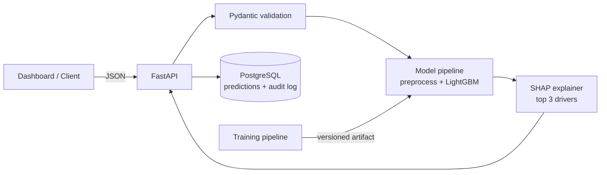

<div align="center">

# CreditLens - Credit Risk Scoring Service

**Loan default prediction with a reason for every decision: a scikit-learn / LightGBM model served through FastAPI, with SHAP explanations and a live dashboard.**


[Overview](#-overview) · [Results](#-results) · [Architecture](#-architecture) · [Quick start](#-quick-start) · [API](#-api-overview) · [Methodology](#-methodology) · [Limitations](#-limitations)

</div>

> ⚠️ **Learning project.** Built on a public dataset to demonstrate an end-to-end ML workflow. It is not a real credit decisioning system and must not be used to make real lending decisions.

---

## 📌 Overview

Most loan-default projects stop at a notebook and a single accuracy number. This one covers the full path:

1. **Analyse** the data (missing values, outliers, leakage risks)
2. **Compare** a simple baseline against a stronger model
3. **Evaluate** with metrics that suit imbalanced data
4. **Explain** every prediction with SHAP, since lenders must justify decisions
5. **Check fairness** across groups
6. **Serve** the model through a validated API
7. **Record** every prediction, model version and explanation for audit

## ✨ Features

- **Risk score API:** `/predict` returns a default probability, a risk band and the **top 3 risk drivers**
- **Baseline vs. final model:** logistic regression compared with LightGBM, with numbers side by side
- **Imbalance-aware evaluation:** ROC-AUC, precision-recall, KS statistic
- **SHAP explainability:** per-prediction reasons and a global feature-importance view
- **Fairness check:** approval and error rates compared across groups
- **Audit trail:** inputs, score, reasons and model version stored in PostgreSQL
- **Dashboard:** enter applicant details and see the score and a Chart.js bar chart of risk drivers
- **Reproducible:** fixed random seeds, pinned requirements, Docker, pytest and CI

## 📊 Results

Measured on the **held-out test set** (20% of the data, never used for tuning), seed 42.


| Model | ROC-AUC | PR-AUC | KS |
|---|---|---|---|
| Logistic regression (baseline) | 0.8433 | 0.5885 | 0.5363 |
| LightGBM (served model) | 0.8442 | 0.5786 | 0.5515 |

LightGBM is only marginally better than the baseline here, which is an honest result: the baseline is strong on this data, and the synthetic data has limited non-linearity.

| Serving metric | Result | How measured |
|---|---|---|
| `/predict` latency | p50 12 ms, p95 16 ms | 200 sequential requests, local, single process, SQLite |
| Tests | 10 passing, 93% coverage | `pytest --cov=src --cov=app` |
| Fairness | approval-rate gap: gender 0.7 pts, age band 9.0 pts | `models/fairness.json` (threshold 0.25) |

Re-measure all of these on your own machine before quoting them anywhere.

## 🧱 Architecture



**Training flow:** raw data → cleaning and feature engineering → train/validation/test split → baseline → tuned model → evaluation → saved artifact with a version tag.

## 🧰 Tech stack

| Layer | Tools |
|---|---|
| Data and ML | Python, pandas, NumPy, scikit-learn, LightGBM, SHAP |
| API | FastAPI, Pydantic |
| Storage | PostgreSQL, SQLAlchemy |
| Frontend | HTML, CSS, JavaScript, Chart.js |
| DevOps | Docker, GitHub Actions, pytest |

## 🚀 Quick start

**Prerequisites:** Python 3.12, or Docker and Docker Compose

```bash
# 1. Clone
git clone https://github.com/Prathamesh625/explainable-credit-risk.git
cd explainable-credit-risk

# 2. Install and train (uses synthetic data by default, no download needed)
pip install -r requirements-dev.txt
python -m src.train

# 3a. Run locally (SQLite)
uvicorn app.main:app --reload

# 3b. ...or run with Docker (PostgreSQL + API)
docker compose up --build

# 4. Test
pytest --cov=src --cov=app
```

- API docs (Swagger): http://localhost:8000/docs
- Dashboard: http://localhost:8000/dashboard

## 📡 API overview

| Method | Endpoint | Description |
|---|---|---|
| `POST` | `/predict` | Score an applicant and return top-3 reasons |
| `GET` | `/predictions/{id}` | Retrieve a stored prediction and explanation |
| `GET` | `/model/info` | Active model version, training date, metrics |
| `GET` | `/health` | Liveness check |

**Example request**

```bash
curl -X POST http://localhost:8000/predict \
  -H "Content-Type: application/json" \
  -d '{"age":34,"income":52000,"loan_amount":15000,"employment_years":6,"credit_history_length":8,"num_open_accounts":4,"num_late_payments":1,"debt_to_income":0.29,"home_ownership":"RENT"}'
```

**Example response** (real output from the synthetic-data model)

```json
{
  "prediction_id": 1,
  "default_probability": 0.0999,
  "risk_band": "low",
  "top_reasons": [
    {"feature": "debt_to_income", "label": "Debt-to-income ratio", "value": 0.29, "impact": -0.8426, "direction": "decreases risk"},
    {"feature": "home_ownership", "label": "Home ownership", "value": "RENT", "impact": 0.2326, "direction": "increases risk"},
    {"feature": "loan_amount", "label": "Loan amount", "value": 15000.0, "impact": -0.2144, "direction": "decreases risk"}
  ],
  "model_version": "1.0.0"
}
```

`impact` is the SHAP value in log-odds: positive raises predicted risk, negative lowers it.

## 🔬 Methodology

**1. Data analysis (pandas)**
Missing values, outliers, class balance, distributions, correlations and a single-feature leakage check are in `notebooks/01_eda.ipynb`.
Findings on the synthetic data: no missing values, a 21.6% default rate, and risk rises sharply once debt-to-income passes 0.8 (about 10% default below it, about 31% just above, 45% above 1.0). Renters default more often (26.5%) than owners (15.0%), and default rate climbs with late payments (15% with none, about 40% with three). These patterns are why a tree model and SHAP are worth comparing against a linear baseline.

**2. Avoiding data leakage**
Preprocessing (imputation, scaling, encoding) is fit on the training split only. The validation set is used for early stopping, and the test set is used once for the final report. The sensitive attribute `gender` is excluded from the model features and used only in the fairness audit.

**3. Handling imbalance**
Metrics focus on PR-AUC and KS rather than accuracy. The baseline uses class weights. For LightGBM I first tried `scale_pos_weight` (ROC-AUC 0.838, PR-AUC 0.563 on the test set), then removed it and lowered `num_leaves` to 15 with a learning rate of 0.05, which gave 0.844 and 0.579. I changed those settings together, so I can't attribute the gain to one of them. I did not try SMOTE.

**4. Model comparison**
A logistic regression baseline is trained first, then LightGBM with early stopping. Both are reported side by side. LightGBM is the served model because SHAP's `TreeExplainer` gives exact per-prediction attributions for tree models.

**5. Explainability**
SHAP values give each prediction its top drivers, and global SHAP plots show what the model relies on overall.

**6. Fairness check**
Approval rate and error rates are compared across gender and age band at a 0.25 decision threshold (`models/fairness.json`). On the synthetic data the gender gap is under 1 point and the age-band gap is about 9 points. On a real dataset I would first check whether the age-band gap reflects genuine differences in default rates or acts as a proxy for something else, since the model never sees gender or age bands directly but can learn correlated features (here, employment and credit-history length are capped by age). I would also compare false-positive and false-negative rates, not just approval rates, test other thresholds, and confirm which attributes may legally be used in the target market.

## 🧪 Testing

```bash
pytest --cov=src --cov=app
```

| Test | What it covers |
|---|---|
| Input validation | Bad or missing fields return clear 422 errors |
| Prediction contract | Score is between 0 and 1, and exactly 3 reasons are returned |
| Reproducibility | Same input and model version give the same output |
| Persistence | Every prediction is stored with its model version |

## 🗂️ Project structure

```
creditlens/
├── app/                 # FastAPI app
│   ├── main.py          # routes
│   ├── schemas.py       # Pydantic validation
│   ├── db.py            # SQLAlchemy audit table
│   └── static/index.html  # dashboard (Chart.js)
├── src/
│   ├── config.py        # features, thresholds
│   ├── data.py          # synthetic generator + loader
│   ├── train.py         # baseline vs LightGBM, saves artifacts
│   ├── metrics.py       # ROC-AUC, PR-AUC, KS
│   ├── fairness.py      # group audit
│   └── scoring.py       # prediction + SHAP reasons
├── tests/               # API, training, metrics tests
├── notebooks/01_eda.ipynb  # exploratory analysis
├── data/                # raw/ (not committed), README.md
├── models/              # trained artifacts (not committed)
├── Dockerfile, docker-compose.yml, requirements*.txt
└── .github/workflows/ci.yml
```


## 🐞 Problems I faced

> Replace with your real notes.

- _Example: first model scored suspiciously high AUC because of a leaked column._
- _Example: probabilities were poorly calibrated until I checked a calibration curve._

## 🗺️ Roadmap

- [ ] Probability calibration
- [ ] Drift detection (PSI) and a retraining trigger
- [ ] Experiment tracking and a model registry (MLflow)
- [ ] Batch scoring endpoint

## 📄 License

MIT. See [LICENSE](LICENSE). Dataset licence: see `data/README.md`.

---

<div align="center">

Built by [Prathamesh Thorat](https://github.com/Prathamesh625) · [LinkedIn](https://linkedin.com/in/thorat-prathamesh)

</div>